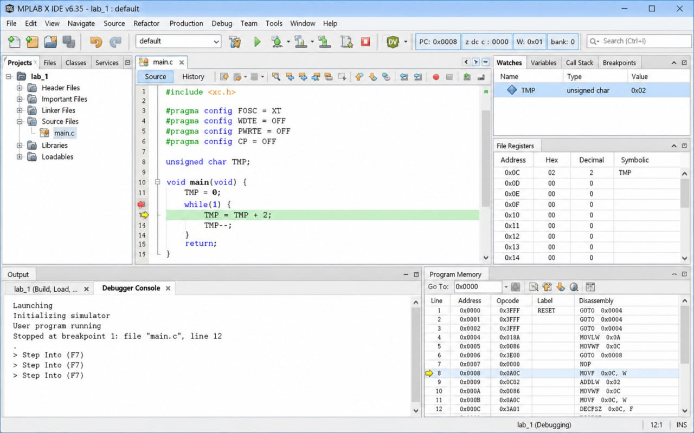
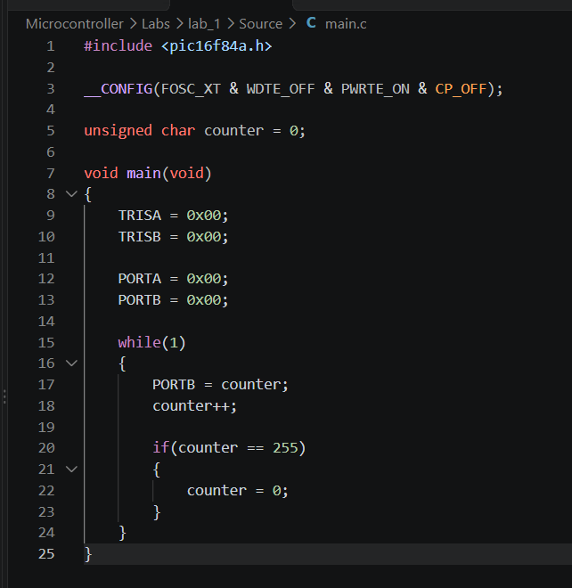

# Лабораторна робота №1

## Тема

Створення проєкту в MPLAB та написання програми мовою С для мікроконтролера PIC16F84A.

---

# Мета роботи

Метою лабораторної роботи є ознайомлення із середовищем розробки MPLAB, набуття практичних навичок створення проєкту для мікроконтролера PIC16F84A, написання програми мовою C, її компіляції та перевірки роботи за допомогою вбудованого симулятора MPLAB SIM.

---

# Хід виконання роботи

Під час виконання лабораторної роботи було створено новий проєкт у середовищі MPLAB. Для компіляції програми було використано компілятор **HI-TECH PICC**, а цільовим мікроконтролером обрано **PIC16F84A**.

Після створення проєкту до нього було додано файл **main.c**, у якому реалізовано тестову програму.

Для підключення бібліотеки та конфігурації мікроконтролера використано наступний код:

```c
#include <pic16f84a.h>

__CONFIG(FOSC_XT & WDTE_OFF & PWRTE_ON & CP_OFF);
```

Після цього було налаштовано напрямки роботи портів:

```c
TRISA = 0x00;
TRISB = 0x00;

PORTA = 0x00;
PORTB = 0x00;
```

Основний цикл програми виконується безперервно та змінює значення змінної, яка виводиться на порт **PORTB**.

```c
while(1)
{
    PORTB = counter;
    counter++;
}
```

Після написання програми було виконано компіляцію проєкту. Помилок компіляції не виявлено, у результаті чого було успішно сформовано файл **HEX**.

Наступним етапом стало тестування програми за допомогою симулятора **MPLAB SIM**. Для аналізу виконання використовувалися стандартні інструменти середовища:

- Program Memory;
- File Registers;
- Special Function Registers;
- Watch.

У процесі симуляції було перевірено правильність роботи програми та зміну значень регістрів під час виконання команд.

---

# Результат виконання

Після завершення всіх етапів лабораторної роботи було отримано працездатний проєкт, який успішно компілюється та виконується у середовищі MPLAB.



Код програми [тут](https://github.com/Nazar175/Microcontroller/blob/main/Labs/lab_1/Source/main.c).

---

# Висновок

У ході виконання лабораторної роботи було отримано практичні навички роботи із середовищем MPLAB та компілятором HI-TECH PICC. Було створено власний проєкт для мікроконтролера PIC16F84A, написано програму мовою C, виконано її компіляцію та перевірено правильність роботи за допомогою симулятора MPLAB SIM. Також було досліджено роботу пам'яті програм, регістрів та засобів налагодження, що дозволило краще зрозуміти принцип роботи мікроконтролерів.