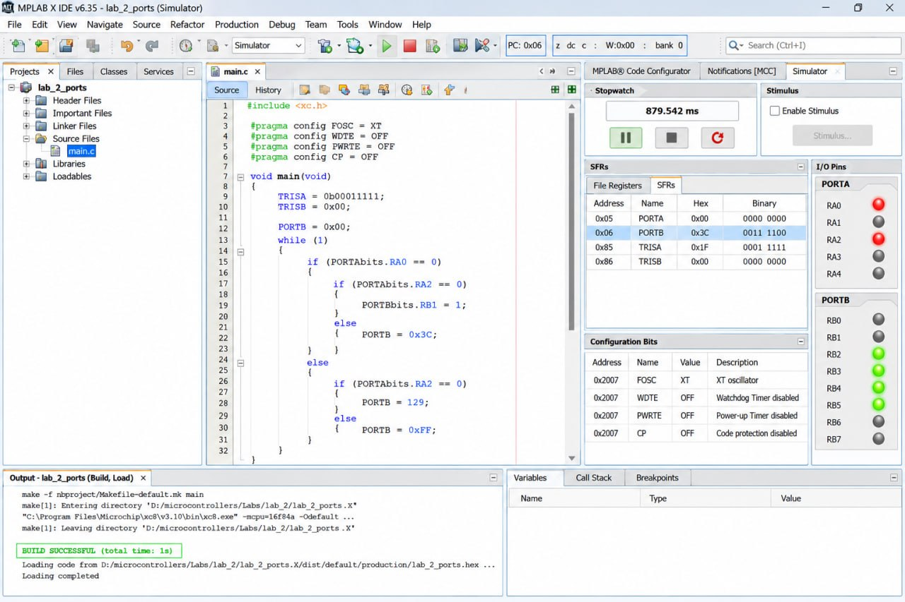

# Лабораторна робота №2
## Дослідження портів вводу/виводу мікроконтролера PIC16F84A

### Мета роботи

На прикладі мікроконтролера PIC16F84A вивчити режими роботи портів вводу/виводу та особливості їх ініціалізації. Ознайомитися з введенням і виведенням дискретних сигналів, навчитися працювати з регістрами TRISA, TRISB, PORTA та PORTB, а також освоїти принципи створення і моделювання електронних схем у середовищі Proteus VSM.

### Завдання роботи

1. Ознайомитися з особливостями портів вводу/виводу мікроконтролера PIC16F84A.
2. Створити програму для роботи з портами мікроконтролера мовою C.
3. Налаштувати напрямки роботи портів за допомогою регістрів TRISA та TRISB.
4. Реалізувати зчитування дискретних сигналів із кнопок і керування світлодіодами.
5. Підготувати програму до компіляції та отримання HEX-файлу.
6. Створити схему мікроконтролерного пристрою в Proteus VSM.
7. Перевірити принцип роботи програми за допомогою моделювання.
8. Ознайомитися з принципом роботи кодового замка на основі мікроконтролера.

### Теоретичні відомості

Мікроконтролер PIC16F84A має два порти вводу/виводу: PORTA та PORTB.

**PORTA** містить п'ять ліній RA0–RA4. **PORTB** містить вісім ліній RB0–RB7. Кожну лінію можна налаштувати на введення або виведення цифрових сигналів.

Для налаштування напрямку роботи портів використовуються регістри TRISA і TRISB. Якщо відповідний біт регістра TRIS має значення `1`, вивід працює як вхід. Якщо біт має значення `0`, вивід працює як вихід.

Регістри PORTA та PORTB використовуються для читання стану вхідних сигналів і керування вихідними сигналами. Наприклад, при підключенні світлодіода до виходу мікроконтролера можна керувати його ввімкненням і вимкненням за допомогою програмного коду.

Під час роботи з портами потрібно враховувати особливості їх електричної організації. Зокрема, вивід RA4 має вихід з відкритим стоком, а для входів PORTA не передбачені внутрішні підтягувальні резистори. Для коректного підключення кнопок можуть використовуватися зовнішні резистори.

### Хід виконання роботи

#### Налаштування портів

На першому етапі було розглянуто призначення регістрів TRISA, TRISB, PORTA та PORTB. Для демонстрації роботи портів було обрано два входи RA0 і RA1 та вісім виходів RB0–RB7.

Входи RA0 і RA1 використовуються для зчитування стану кнопок. Виходи PORTB призначені для керування світлодіодами.

#### Створення програми

Було підготовлено програму мовою C для мікроконтролера PIC16F84A. У програмі виконуються такі дії:

1. Налаштовуються RA0 і RA1 як входи.
2. Усі лінії PORTB налаштовуються як виходи.
3. Встановлюється початковий стан виходів.
4. У нескінченному циклі зчитується стан двох кнопок.
5. Значення входів передається на RB0 і RB1, завдяки чому стан кнопок відображається світлодіодами.

Таким чином, програма демонструє основний принцип роботи цифрових входів і виходів мікроконтролера.

#### Створення схеми в Proteus VSM

Для моделювання пристрою передбачено використання таких компонентів:

- мікроконтролер PIC16F84A;
- два перемикачі для формування вхідних сигналів;
- вісім жовтих світлодіодів;
- струмообмежувальні резистори;
- необхідні з'єднання та термінали живлення.

Компоненти розміщуються на робочому полі редактора ISIS і з'єднуються відповідно до призначення входів і виходів. Для коректної роботи світлодіоди підключаються через струмообмежувальні резистори.

#### Компіляція та моделювання

Після підготовки вихідного коду необхідно виконати його компіляцію сумісним компілятором для PIC16F84A та отримати HEX-файл. Потім HEX-файл вказується у властивостях мікроконтролера в Proteus VSM. Тактова частота процесора встановлюється на рівні 4 МГц, як зазначено в методичних вказівках.

Під час моделювання перевіряється реакція світлодіодів на зміну стану перемикачів. Якщо схема та програма налаштовані правильно, зміна сигналу на RA0 повинна відображатися на RB0, а зміна сигналу на RA1 — на RB1.

#### Ознайомлення з роботою кодового замка

У другій частині розглядається кодовий замок на основі PIC16F84A. Його робота полягає в опитуванні кнопок клавіатури, збереженні введених значень і порівнянні їх із кодом, записаним у програмі.

Якщо введений код правильний, мікроконтролер активує вихід RA0 та керувальний пристрій. Якщо код неправильний, активується вихід RA1. Для введення нової комбінації використовується кнопка CLR.

Для повної реалізації цієї частини необхідно додатково визначити підключення клавіатури та керувальних пристроїв відповідно до схеми кодового замка.

### Результати роботи

Під час виконання лабораторної роботи було розглянуто структуру портів вводу/виводу мікроконтролера PIC16F84A, призначення керувальних регістрів та принципи обміну дискретними сигналами.

Було підготовлено програмний приклад, у якому два входи використовуються для зчитування стану кнопок, а виходи PORTB — для відображення цього стану за допомогою світлодіодів.

Також було розглянуто послідовність створення електронної схеми в Proteus VSM, підключення HEX-файлу та запуску моделювання. Окремо опрацьовано принцип роботи кодового замка, що використовує клавіатуру для перевірки введеного коду.

### Відповіді на контрольні питання

**1. Яке призначення і функціональні особливості портів PIC16F8X?**

Порти призначені для обміну цифровими сигналами між мікроконтролером і зовнішніми пристроями. PIC16F84A має п'ятибітовий порт PORTA та восьмибітовий порт PORTB. Кожну лінію можна налаштувати на введення або виведення. Окремі лінії мають додаткові функціональні особливості, наприклад RA4 має вихід з відкритим стоком, а RB4–RB7 можуть використовуватися для формування переривання при зміні стану входів.

**2. Для чого призначені регістри TRISA, TRISB та PORTA, PORTB?**

TRISA і TRISB визначають напрямок роботи відповідних ліній портів. Значення `1` задає вхід, а `0` — вихід. PORTA і PORTB використовуються для читання сигналів на входах і запису значень, які керують вихідними лініями.

**3. Як відбувається процес модифікації біта порту?**

Модифікація біта може виконуватися за допомогою операцій встановлення або очищення окремого біта. У PIC16F84A команди типу read-modify-write спочатку читають значення порту, змінюють потрібний біт, а потім записують результат у вихідний фіксатор. Тому потрібно враховувати фактичний стан виводів і можливі затримки стабілізації сигналу.

**4. Як відбувається опитування стану кнопки?**

Вивід мікроконтролера налаштовують як вхід. Кнопка змінює рівень напруги на цьому вході. За допомогою підтягувального резистора формується визначений логічний рівень, коли кнопка не натиснута. Програма періодично зчитує регістр порту та перевіряє відповідний біт. У схемі з підтягуванням до живлення натискання кнопки на землю відповідає логічному нулю.

**5. Як створити проєкт на основі мікроконтролера в Proteus VSM?**

Потрібно створити новий дизайн, вибрати PIC16F84A та інші необхідні компоненти з бібліотеки, розмістити їх на робочому полі й з'єднати відповідно до схеми. Потім у властивостях мікроконтролера вказати шлях до HEX-файлу, встановити потрібну тактову частоту, зберегти проєкт і запустити моделювання.

**6. Як працює типовий кодовий замок на основі мікроконтролера?**

Типовий кодовий замок зчитує натискання кнопок клавіатури, формує введену комбінацію та порівнює її зі збереженим кодом. Якщо код правильний, пристрій активує механізм відкривання дверей. Якщо код неправильний, доступ не надається. У конкретній схемі також можуть бути передбачені керування освітленням і кнопка відкривання зсередини приміщення.

**7. Як працює досліджуваний кодовий замок?**

Мікроконтролер відстежує стан кнопок, зберігає введену комбінацію та після натискання кнопки підтвердження порівнює її із запрограмованим кодом. У разі правильного введення активується RA0 і керувальний пристрій. Якщо код неправильний, активується світлодіод на RA1. Кнопка CLR очищує попередні введені дані.

**8. Яка особливість опитування кнопок клавіатури досліджуваного кодового замка?**

Стан клавіатури можна зберігати як набір бітів, що показують, які кнопки натискалися, або як послідовність байтів, що містять код кнопки та порядок її натискання. Перший варіант простіший, але не враховує порядок натискання та не дозволяє повноцінно використовувати повторення кнопок. Другий варіант складніший, але дозволяє розрізняти послідовності введення та підтримувати повторення однакових кнопок.

### Висновок

У результаті виконання лабораторної роботи було розглянуто принципи роботи портів вводу/виводу мікроконтролера PIC16F84A, призначення регістрів TRISA, TRISB, PORTA та PORTB, а також особливості введення дискретних сигналів із кнопок і керування світлодіодами.

Було підготовлено приклад програми мовою C та розглянуто порядок створення схеми й налаштування моделювання в Proteus VSM. Також було вивчено алгоритм роботи кодового замка, який перевіряє введену комбінацію та керує вихідними пристроями.