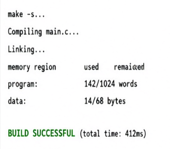
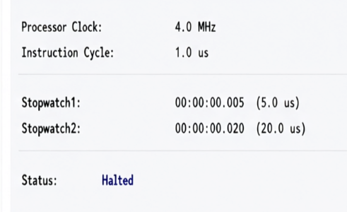

# Лабораторна робота № 4
## Формування сигналів керування та динамічна індикація на PIC16F84A

### Мета роботи

Вивчити способи формування сигналів керування та індикації на прикладі мікроконтролера PIC16F84A. Ознайомитися з принципом роботи семисегментного індикатора та навчитися реалізовувати динамічну індикацію двохрозрядного десяткового числа.

### Завдання роботи

1. Розробити програму для виведення дня народження на двохрозрядний семисегментний індикатор.
2. Налаштувати порти мікроконтролера для керування сегментами та вибору розрядів.
3. Реалізувати почергове вмикання двох розрядів індикатора.
4. Забезпечити частоту оновлення розрядів відповідно до вимог методичних вказівок.
5. Виконати компіляцію програми в MPLAB та перевірити її роботу в симуляторі Proteus.
6. Перевірити часові параметри за допомогою програмного секундоміра MPLAB.

### Теоретичні відомості

Семисегментний індикатор (ССІ) призначений для відображення десяткових цифр за допомогою семи світлових сегментів. Комбінація увімкнених сегментів формує відповідну цифру. Додатково індикатор може мати восьмий сегмент для відображення десяткової крапки.

Індикатори поділяються на два основні типи: зі спільним катодом і зі спільним анодом. У цій роботі використовується індикатор зі спільним катодом.

Існують два способи керування індикаторами: статичний і динамічний. За статичного способу кожен розряд керується окремо. За динамічного способу розряди вмикаються почергово, а лінії сегментів використовуються спільно.

Динамічна індикація дає змогу зменшити кількість виводів мікроконтролера, необхідних для керування кількома розрядами. Завдяки швидкому почерговому перемиканню розрядів спостерігач сприймає зображення як постійне.

### Індивідуальне завдання

Індивідуальним завданням є відображення дня народження на дворозрядному семисегментному індикаторі.

Для формування зображення цифр використовується таблиця кодів сегментів. Кожному десятковому числу від 0 до 9 відповідає певна комбінація бітів, яка передається на порт PORTB.

Десяткова цифра десятків визначається діленням заданого числа на 10, а цифра одиниць — обчисленням залишку від ділення на 10.

Для вибору розрядів використовуються керувальні сигнали на RA2 і RA3. У кожний момент часу активним є один розряд індикатора.

### Розрахунок часових параметрів

Частота генератора мікроконтролера:

\[
F_{osc}=4\,\text{МГц}
\]

Тривалість машинного циклу:

\[
T_{CY}=\frac{4}{F_{osc}}=1\,\text{мкс}
\]

За попереднього дільника 1:64 тривалість одного кроку таймера становить:

\[
T_{TMR0}=1\,\text{мкс}\cdot64=64\,\text{мкс}
\]

Для отримання приблизно 6,4 мс таймер завантажується значенням 156:

\[
N=256-156=100
\]

\[
T=100\cdot64\,\text{мкс}=6{,}4\,\text{мс}
\]

Оскільки розряди вмикаються почергово, повний цикл оновлення двох розрядів становить приблизно:

\[
T_{cycle}=2\cdot6{,}4=12{,}8\,\text{мс}
\]

Отримане значення перебуває в межах 10–20 мс, зазначених у завданні. Фактичний інтервал потрібно перевірити в MPLAB.

### Опис програми

Спочатку програма налаштовує порти мікроконтролера. PORTB використовується для передавання кодів сегментів, а виводи RA2 і RA3 — для вибору розряду індикатора.

Далі налаштовується регістр OPTION_REG. Таймер TMR0 працює від внутрішнього тактового сигналу, а попередній дільник встановлюється на 1:64. У регістр TMR0 записується початкове значення 156.

Після налаштування таймера очищується прапорець T0IF, дозволяється переривання TMR0 та вмикаються глобальні переривання.

Обробник переривання виконує такі дії:

1. Перевіряє прапорець переповнення T0IF.
2. Перезавантажує таймер початковим значенням.
3. Скидає прапорець переривання.
4. Вимикає обидва розряди індикатора.
5. Вибирає цифру десятків або одиниць.
6. Передає відповідний код сегментів на PORTB.
7. Вмикає потрібний розряд і перемикає вибір для наступного переривання.

Основна програма містить нескінченний цикл, у якому очікується наступне переривання. Завдяки цьому динамічна індикація працює незалежно від виконання інших дій основної програми.

### 7. Перевірка роботи

Для перевірки програми передбачено такі дії:

1. Створити проєкт для PIC16F84A у середовищі MPLAB.
2. Додати файл `main.c` та встановити параметри генератора 4 МГц.
3. Скомпілювати програму та перевірити відсутність помилок.
4. Відкрити схему в Proteus і підключити семисегментний індикатор відповідно до принципової схеми.
5. Завантажити отриманий файл HEX у властивості мікроконтролера.
6. Запустити симуляцію та перевірити правильність відображення дня народження.
7. За допомогою програмного секундоміра MPLAB перевірити часові параметри перемикання розрядів.

### Результати роботи

Підготовлено програму для динамічної індикації двохрозрядного числа на мікроконтролері PIC16F84A. Реалізовано таблицю кодів цифр, почергове керування розрядами та використання таймера TMR0 для формування часових інтервалів.

Розрахунковий інтервал між перемиканнями розрядів становить приблизно 6,4 мс, а повний цикл оновлення двох розрядів — близько 12,8 мс. Фактичну роботу програми та часові параметри необхідно підтвердити після компіляції й симуляції.

### Відповіді на контрольні питання

**1. За допомогою яких засобів можна вивести інформацію з мікроконтролера?**

Інформацію можна виводити за допомогою світлодіодів, семисегментних індикаторів, рідкокристалічних дисплеїв та інших пристроїв відображення.

**2. Що таке ССІ?**

ССІ — це семисегментний цифровий індикатор, який відображає цифри за допомогою семи світлових сегментів.

**3. Яка особливість статичної індикації?**

За статичної індикації кожен розряд керується незалежно та постійно відображає задану цифру, доки не зміниться код керування.

**4. Яким чином формується символ для відображення на ССІ?**

Символ формується подаванням на сегменти певної комбінації логічних рівнів. Для кожної цифри використовується відповідний код.

**5. Як працювати з табличними даними?**

У програмі створюють масив кодів символів. Потрібний код отримують за індексом, який відповідає цифрі, після чого передають його на порт мікроконтролера.

**6. Яка особливість динамічної індикації, її переваги та недоліки?**

За динамічної індикації розряди вмикаються почергово через спільні лінії сегментів. Перевагами є зменшення кількості потрібних виводів і простіша схема підключення. Недоліками є необхідність постійного оновлення розрядів і можливість мерехтіння за недостатньої частоти перемикання.

**7. Як здійснюється економія виводів при роботі з ССІ?**

Економія досягається використанням спільної шини сегментів для всіх розрядів і окремих керувальних сигналів для почергового вибору кожного розряду.

**8. Яка послідовність дій для забезпечення динамічної індикації?**

Спочатку встановлюється код сегментів першої цифри, після чого вмикається перший розряд. Далі він вимикається, на шину подається код другої цифри й активується другий розряд. Цикл повторюється безперервно.

**9. Яким чином можна зменшити кількість використовуваних портів при організації інтерфейса вводу?**

Для зменшення кількості виводів можна використовувати матричну клавіатуру, у якій кнопки розміщені на перетині рядків і стовпців.

**10. Коли доцільно використовувати клавіатурну матрицю?**

Матричну клавіатуру доцільно використовувати, коли необхідно підключити багато кнопок, а кількість доступних виводів мікроконтролера обмежена.

**11. Як відбувається сканування клавіатурної матриці?**

Мікроконтролер по черзі активує лінії стовпців і зчитує стани рядків. За комбінацією активного стовпця та рядка визначається натиснута кнопка.

**12. Які є методи економії виводів мікроконтролера при організації клавіатурної матриці?**

Основний метод — об'єднання кнопок у рядки та стовпці. Кількість кнопок визначається добутком кількості рядків на кількість стовпців.

**13. Яка функція дешифратора та лічильника у схемі зв’язку мікроконтролера та клавіатурної матриці?**

Дешифратор перетворює код керування на сигнал вибору відповідної лінії. Лічильник може послідовно змінювати номер лінії, що опитується, забезпечуючи автоматичне сканування клавіатури.

### Висновок

Під час лабораторної роботи розглянуто принципи формування сигналів керування та індикації на мікроконтролері PIC16F84A. Вивчено відмінності між статичною та динамічною індикацією, принцип формування кодів семисегментного індикатора й використання таблиці символів. Підготовлено програму, яка почергово вмикає розряди індикатора та використовує таймер TMR0 для формування часових інтервалів. Розрахований цикл оновлення двох розрядів становить приблизно 12,8 мс. Перевірка фактичної роботи програми виконується після компіляції та симуляції в MPLAB і Proteus.
