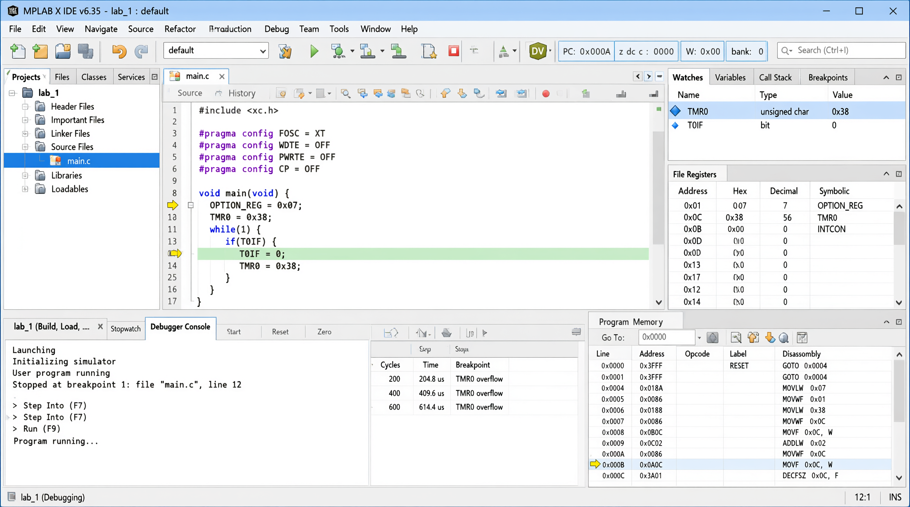

# Практична робота № 3
## Використання таймера TMR0 мікроконтролера PIC16F84A

### Мета роботи

Отримати практичні навички написання та відлагодження програм у середовищі MPLAB, вивчити принцип роботи модуля TMR0 мікроконтролера PIC16F84A та навчитися налаштовувати його за допомогою регістра OPTION_REG.

### Завдання роботи

1. Закріпити знання щодо використання модуля TMR0.
2. Вивчити призначення робочих бітів регістра OPTION_REG.
3. Налаштувати TMR0 для підрахунку 200 імпульсів від внутрішнього джерела без попереднього дільника.
4. Реалізувати генерацію дискретного сигналу на виводі RB0 з періодом 220 мс.
5. Забезпечити періодичне встановлення прапорця T0IF з інтервалом приблизно 50 мс.
6. Реалізувати формування часового інтервалу приблизно 500 мс із використанням попереднього дільника.
7. Ознайомитися з перевіркою часових параметрів за допомогою секундоміра MPLAB.

### Теоретичні відомості

TMR0 — це апаратний 8-розрядний таймер/лічильник мікроконтролера PIC16F84A. Його поточне значення зберігається в регістрі TMR0, який доступний для читання та запису.

Таймер може працювати від внутрішнього тактового сигналу або від зовнішніх імпульсів, що надходять на вивід RA4/T0CKI.

Під час переходу значення TMR0 від `0xFF` до `0x00` відбувається переповнення, після якого встановлюється прапорець T0IF у регістрі INTCON. Програма може перевіряти цей прапорець і визначати момент завершення відліку.

Керування таймером здійснюється за допомогою регістра OPTION_REG. Він дає змогу вибирати джерело тактового сигналу, режим роботи попереднього дільника та коефіцієнт поділу.

### Призначення основних бітів OPTION_REG

| Біт | Назва | Призначення |
|---|---|---|
| 7 | RBPU | Керування підтягувальними резисторами PORTB |
| 6 | INTEDG | Вибір фронту зовнішнього переривання |
| 5 | T0CS | Вибір внутрішнього або зовнішнього джерела тактового сигналу |
| 4 | T0SE | Вибір фронту для зовнішнього лічильника |
| 3 | PSA | Вибір підключення попереднього дільника до TMR0 або WDT |
| 2–0 | PS2–PS0 | Вибір коефіцієнта поділу |

Для роботи TMR0 від внутрішнього джерела необхідно встановити T0CS у нуль. Для використання попереднього дільника його підключають до TMR0 за допомогою біта PSA та вибирають потрібний коефіцієнт поділу бітами PS2–PS0.

### Розрахунок часових параметрів

Для кварцового резонатора з частотою 4 МГц тривалість машинного циклу становить:

\[
T_{мц}=\frac{4}{F_{osc}}=1\text{ мкс}
\]

Без попереднього дільника TMR0 може рахувати до 256 імпульсів за один цикл переповнення, якщо початкове значення регістра дорівнює нулю.

Для підрахунку 200 імпульсів початкове значення визначається за формулою:

\[
TMR0=256-200=56
\]

За використання попереднього дільника 1:256 кожен крок TMR0 відповідає приблизно 256 мкс.

Для інтервалу близько 50 мс потрібно:

\[
N=\frac{50000}{256}\approx195{,}31
\]

Використано 195 кроків таймера. Для цього початкове значення становить:

\[
TMR0=256-195=61
\]

Номінальна тривалість такого відліку:

\[
T=195\cdot256=49920\text{ мкс}=49{,}92\text{ мс}
\]

Для формування інтервалу близько 500 мс цей відлік повторюється десять разів:

\[
T\approx10\cdot49{,}92=499{,}2\text{ мс}
\]

Фактичні значення можуть відрізнятися через час виконання команд і програмного опитування прапорця T0IF.

### Хід виконання роботи

#### Підрахунок 200 імпульсів

У першому режимі TMR0 налаштовано на роботу від внутрішнього джерела без попереднього дільника. У регістр TMR0 записується початкове значення 56.

Після скидання прапорця T0IF програма очікує переповнення таймера. Після встановлення прапорця відлік вважається завершеним.

#### Генерація сигналу на RB0

У другому режимі реалізовано програмне перемикання виходу RB0. Для формування високого та низького рівнів використовуються повторні переповнення TMR0 без попереднього дільника.

Для отримання періоду 220 мс передбачено високий рівень тривалістю приблизно 20 мс і низький рівень тривалістю приблизно 200 мс. Кількість переповнень використовується для наближеного формування заданих часових інтервалів.

Оскільки програмне опитування прапорця створює додаткові часові витрати, точність необхідно перевірити в симуляторі та скоригувати за результатами вимірювання.

#### Періодичне встановлення T0IF

У третьому режимі попередній дільник підключено до TMR0 із коефіцієнтом 1:256. Початкове значення таймера встановлено в 61, що відповідає приблизно 49,92 мс до переповнення.

Програма очікує встановлення прапорця T0IF, після чого скидає його та повторює відлік.

#### Формування інтервалу 500 мс

У четвертому режимі десять послідовних інтервалів тривалістю приблизно 49,92 мс формують загальний часовий інтервал близько 499,2 мс.

Після завершення відліку змінюється стан виходу RB0. Такий підхід демонструє можливість отримання довших часових інтервалів за допомогою кількох переповнень апаратного таймера.

### Перевірка програми в MPLAB

Для перевірки роботи програми необхідно:

1. Створити проєкт для мікроконтролера PIC16F84A.
2. Додати файл із програмою та виконати компіляцію.
3. Запустити симуляцію або покрокове виконання програми.
4. Відкрити вікно секундоміра через меню Debugger → Stopwatch.
5. Перевірити зміну значень TMR0 і прапорця T0IF.
6. Порівняти виміряні інтервали з розрахованими значеннями.

### Результати роботи

У роботі розглянуто принцип роботи апаратного таймера TMR0 та призначення регістра OPTION_REG. Виконано розрахунок початкових значень таймера для підрахунку 200 імпульсів і формування часових інтервалів.

Розглянуто програмну перевірку прапорця T0IF, використання попереднього дільника з коефіцієнтом 1:256 та формування довших інтервалів шляхом повторення відліків.

Для завершення експериментальної частини необхідно перевірити фактичні часові параметри в MPLAB та за потреби скоригувати програму з урахуванням часу виконання команд.

### Відповіді на контрольні питання

**1. Яке призначення таймера?**

Таймер призначений для вимірювання часових інтервалів, формування затримок і визначення моментів настання подій. TMR0 може працювати як таймер від внутрішнього джерела або як лічильник зовнішніх імпульсів.

**2. Для чого використовується попередній дільник?**

Попередній дільник зменшує частоту імпульсів, що надходять до таймера, та дає змогу отримувати довші часові інтервали без необхідності рахувати кожен машинний цикл окремо.

**3. Які компоненти містить TMR0?**

Модуль містить 8-розрядний регістр TMR0, програмований попередній дільник, мультиплексор вибору джерела тактового сигналу, схему вибору фронту зовнішнього сигналу та формувач прапорця переповнення.

**4. Що таке сторожовий таймер?**

Сторожовий таймер WDT призначений для відновлення роботи мікроконтролера у випадку зависання програми. Якщо програмне забезпечення не скидає WDT у визначений інтервал часу, сторожовий таймер формує сигнал скидання.

**5. Яким керуючим сигналом вибирається режим роботи TMR0 як таймера чи лічильника?**

Режим роботи визначається бітом T0CS регістра OPTION_REG. Значення 0 вибирає внутрішнє джерело тактового сигналу, а значення 1 — зовнішні імпульси на виводі RA4/T0CKI.

**6. Для чого призначений біт PSA?**

Біт PSA визначає, до якого вузла підключається попередній дільник: до TMR0 або до сторожового таймера WDT. При PSA = 0 дільник використовується з TMR0, а при PSA = 1 — з WDT.

**7. Коли буде встановлений біт T0IF в одиницю?**

Прапорець T0IF встановлюється в одиницю при переповненні регістра TMR0, тобто під час переходу його значення від `0xFF` до `0x00`. Прапорець потрібно скидати програмно перед наступним відліком.

### Висновок

Під час практичної роботи розглянуто принцип роботи таймера TMR0 мікроконтролера PIC16F84A та призначення регістра OPTION_REG. Виконано розрахунки початкових значень таймера для підрахунку імпульсів і формування часових інтервалів.

Розглянуто використання прапорця T0IF для визначення переповнення, налаштування попереднього дільника та програмне формування довших затримок шляхом повторення відліків.